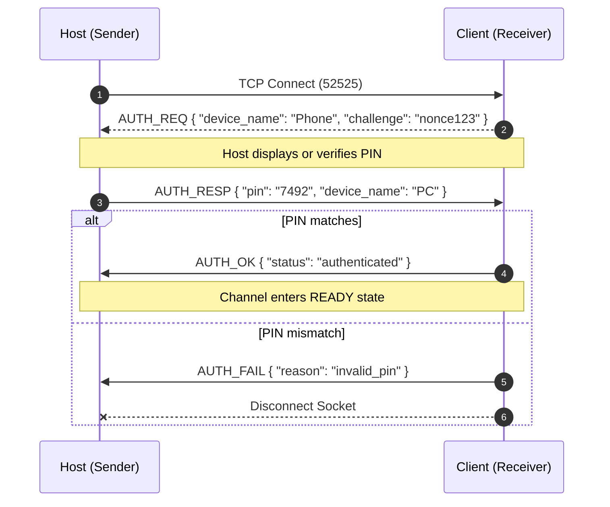
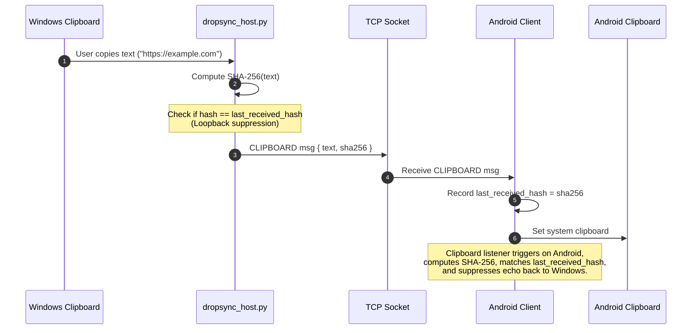

# DropSync Protocol Specification (v1.0)

DropSync is a serverless, peer-to-peer (P2P) local network protocol designed for zero-configuration device discovery, bidirectional clipboard synchronization, and high-throughput chunked file streaming between desktop (Windows/Linux/macOS) and mobile (Android/iOS) devices.

---

## 1. Network Topology & Ports

All communication is strictly confined to the local Wi-Fi / LAN subnet. Zero internet connectivity or cloud servers are involved.

| Service | Protocol | Default Port | Purpose |
| :--- | :--- | :--- | :--- |
| **Discovery Beacon** | UDP (Broadcast / Multicast) | `53535` | Peer discovery & presence announcement |
| **Data & Streaming** | TCP (Stream) | `52525` | Handshake, clipboard events & binary file streaming |

---

## 2. Discovery Protocol (UDP)

Devices periodically announce their presence on the local subnet by broadcasting UDP datagrams to `255.255.255.255:53535` (and optionally multicast `239.255.255.250:53535`) every 2.5 seconds.

### Beacon Datagram (JSON UTF-8)
```json
{
  "magic": "DROPSYNC_BEACON",
  "version": 1,
  "device_id": "a3b1c2d4-e5f6-7a8b-9c0d-1e2f3a4b5c6d",
  "device_name": "VENKAT-PC",
  "platform": "windows",
  "port": 52525,
  "pin_required": true
}
```

### Discovery Response (`DROPSYNC_PONG`)
When a node starts or seeks an immediate peer scan, it sends a probe datagram `{"magic": "DROPSYNC_PROBE", ...}`. Listening peers respond directly with a unicast `DROPSYNC_PONG` containing their device metadata.

---

## 3. TCP Connection & Control Framing

Once discovered, nodes establish a direct TCP connection to the peer's listening port (`52525`).

All control messages (Handshake, Auth, Clipboard, File Offer) adhere to a 9-byte header framing:

```
 0                   1                   2                   3
 0 1 2 3 4 5 6 7 8 9 0 1 2 3 4 5 6 7 8 9 0 1 2 3 4 5 6 7 8 9 0 1
+-+-+-+-+-+-+-+-+-+-+-+-+-+-+-+-+-+-+-+-+-+-+-+-+-+-+-+-+-+-+-+-+
|                      Magic (4 Bytes: "DSYN")                  |
+-+-+-+-+-+-+-+-+-+-+-+-+-+-+-+-+-+-+-+-+-+-+-+-+-+-+-+-+-+-+-+-+
|   Type (1B)   |             Payload Length (4 Bytes, uint32)   |
+-+-+-+-+-+-+-+-+-+-+-+-+-+-+-+-+-+-+-+-+-+-+-+-+-+-+-+-+-+-+-+-+
|                                                               |
|                        Payload Data                           |
|                    (Length bytes, UTF-8 JSON)                 |
+-+-+-+-+-+-+-+-+-+-+-+-+-+-+-+-+-+-+-+-+-+-+-+-+-+-+-+-+-+-+-+-+
```

### Message Types
| Value (`uint8`) | Identifier | Description |
| :--- | :--- | :--- |
| `0x01` | `AUTH_REQ` | Authentication request with device identity and challenge |
| `0x02` | `AUTH_RESP` | PIN verification response |
| `0x03` | `AUTH_OK` | Authentication confirmed; connection authorized |
| `0x04` | `AUTH_FAIL` | Authentication rejected; socket closed |
| `0x05` | `CLIPBOARD` | Synchronized clipboard text payload with SHA-256 digest |
| `0x06` | `FILE_OFFER` | Prompt peer to accept or reject incoming file |
| `0x07` | `FILE_ACCEPT` | Receiver accepts file; sender can proceed with stream |
| `0x08` | `FILE_REJECT` | Receiver rejects file; transfer cancelled |
| `0x10` | `FILE_STREAM` | Binary file transmission stream (see Section 5) |
| `0xFF` | `PING_PONG` | Heartbeat keep-alive |

---

## 4. Handshake & PIN Authentication

To prevent unauthorized devices on open Wi-Fi networks from receiving files or intercepting clipboard data, peers undergo a PIN handshake.



---

## 5. Bidirectional Clipboard Synchronization



### Clipboard Packet Payload (JSON)
```json
{
  "text": "https://github.com/google/gemini",
  "hash": "b2c3d4e5f6a1...",
  "timestamp": 1727278000
}
```

---

## 6. High-Speed Chunked File Transfer Protocol

File transfers use a dedicated streaming header followed by consecutive 64 KB binary chunks. The stream can either run inside the main authenticated connection via `FILE_STREAM` (`0x10`) or over a dedicated high-throughput TCP connection.

### Binary Header Wire Format

```
 0                   1                   2                   3
 0 1 2 3 4 5 6 7 8 9 0 1 2 3 4 5 6 7 8 9 0 1 2 3 4 5 6 7 8 9 0 1
+-+-+-+-+-+-+-+-+-+-+-+-+-+-+-+-+-+-+-+-+-+-+-+-+-+-+-+-+-+-+-+-+
|       'D'     |       'S'     |       'Y'     |       'N'     |  Magic (4 Bytes: 0x44 0x53 0x59 0x4E)
+-+-+-+-+-+-+-+-+-+-+-+-+-+-+-+-+-+-+-+-+-+-+-+-+-+-+-+-+-+-+-+-+
|     File Name Length (2B uint16)     |                        |
+-+-+-+-+-+-+-+-+-+-+-+-+-+-+-+-+-+-+-+                         +
|                File Name (UTF-8, variable length N)           |
|                                                               |
+-+-+-+-+-+-+-+-+-+-+-+-+-+-+-+-+-+-+-+-+-+-+-+-+-+-+-+-+-+-+-+-+
|                                                               |
+                 File Size in Bytes (8 Bytes, uint64)          +
|                                                               |
+-+-+-+-+-+-+-+-+-+-+-+-+-+-+-+-+-+-+-+-+-+-+-+-+-+-+-+-+-+-+-+-+
|                                                               |
|             Binary Body: Streamed in 64 KB (65,536 B)         |
|              Chunks directly to disk (.part file)             |
|                                                               |
+-+-+-+-+-+-+-+-+-+-+-+-+-+-+-+-+-+-+-+-+-+-+-+-+-+-+-+-+-+-+-+-+
```

### Field Breakdown
1. **Magic Bytes (4 Bytes):** Fixed ASCII `DSYN` (`0x44 0x53 0x59 0x4E`).
2. **File Name Length (2 Bytes):** Big-endian `uint16` storing length $N$ of the filename.
3. **File Name ($N$ Bytes):** UTF-8 encoded string (sanitized of directory traversal characters like `..`, `/`, `\`).
4. **File Size (8 Bytes):** Big-endian `uint64` indicating the total file size in bytes ($S$).
5. **Binary Stream Body:** Exactly $S$ bytes read from the socket in $64\text{ KB}$ (`65536` bytes) buffers.

### Safety & Resilience
- **Temporary Part File:** While writing, the receiver writes directly to `<output_dir>/<file_name>.part`.
- **Atomic Rename:** Only when exactly $S$ bytes are received without premature EOF or socket reset, the file is flushed to disk and atomically renamed to `<output_dir>/<file_name>`.
- **Collision Protection:** If `<file_name>` exists, suffixes such as ` (1)`, ` (2)` are inserted before the extension.
- **Low Memory Guarantee:** Because chunks are flushed to disk immediately upon reading, memory overhead never exceeds $64\text{ KB} + \text{socket buffer}$ ($< 50\text{ MB}$ total application RSS even during 100 GB transfers).

---

## 7. Transfer Progress Metrics

During streaming, both sender and receiver calculate metrics at 100 ms intervals:

$$\text{Speed} = \frac{\Delta \text{Bytes}}{\Delta t} \quad (\text{MB/s})$$
$$\text{Progress} = \left(\frac{\text{Bytes Transferred}}{\text{Total Bytes}}\right) \times 100\%$$
$$\text{ETA} = \frac{\text{Total Bytes} - \text{Bytes Transferred}}{\text{Speed}} \quad (\text{seconds})$$
